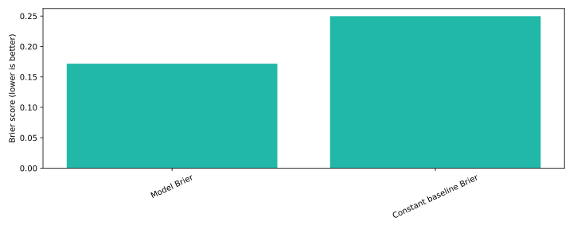

# Sales forecast laboratory

**How much of today’s open pipeline is likely to win in the next 90 days?**

Point-in-time pipeline reconstruction, forward revenue backtests and baseline comparison. Built for a revenue analytics portfolio using [Ledgerly](https://github.com/jungmarker/ledgerly-data), a fictional B2B SaaS business. All records are synthetic. This is a reproducible portfolio implementation, not a claim of deployed customer impact.



## Try it

Python 3.11–3.14 and Git are required. Run from this repository’s root.

```bash
python3 -m venv .venv
source .venv/bin/activate
python -m pip install -r requirements.txt
python scripts/bootstrap.py --seed 42
python run.py --data data --out reports
python -m pytest -q
python -m http.server 8000 --directory reports
```

Open http://localhost:8000 for the report. You can inspect the committed [metrics](reports/metrics.json) and CSV reports immediately without installing anything. The HTML report is also committed as [reports/index.html](reports/index.html); download/open locally to view it. GitHub displays its source.

The bootstrap regenerates all synthetic tables locally; source data and databases are ignored by Git. A self-contained, MIT-licensed generator copy is included in `vendor/ledgerly-data`, pinned to commit `339280a4e8ecd67c3d747f5ba560807b41038dc7`. Regeneration uses a deterministic seed within the dependency environment; library upgrades can alter Faker output. Do not substitute real CRM exports into a public commit.

## What to inspect

Inspect snapshot and FEATURES. The cutoff test proves a future stage cannot change earlier features. Compare backtests.csv with heldout_predictions.csv; lower Brier means better probability forecasts.

Outputs go to `reports/`: a standalone HTML dashboard, SVG chart, machine-readable metrics and CSV evidence. Continuous integration runs unit checks, generates fresh seed-42 data and executes the full analysis. The warehouse additionally runs native dbt build/tests. Workflow results are visible in the Actions tab.

## How it works

Stage event history → point-in-time open-deal snapshots → matured 90-day labels → logistic model → future-period backtests and current pipeline probabilities.

Features are stage at cutoff, source, opportunity type, segment and age. Training snapshots end September 2025; outcomes mature before March/June 2026 evaluation. Held-out deal IDs are removed from training. Terminal stage, current forecast category, close date and amount are excluded from model features.

**Measures:** Brier score and ROC-AUC versus a constant historical win-rate baseline, plus indicative expected pipeline dollars.

## Business interpretation

Use the outputs to ask whether the decision is supportable, what could go wrong and which additional evidence would change the recommendation. The reports intentionally retain limitations and unsuccessful cases. Performance on generated data measures implementation behavior; it does not establish performance on a real employer’s data.

## Employer alignment

See [role-fit research](docs/role-fit.md) for salary-transparent job examples overlapping $150–200k, skill requirements and location/seniority caveats. See [design and limitations](docs/design.md) for deployment considerations and a short interview walkthrough.

## Scope and limitations

Historical amount versions do not exist. Dollar backtests use latest exported amounts and cannot establish real historical revenue forecast accuracy. Segment/source are assumed stable. Repeated snapshots and synthetic dynamics limit inference. No post-cutoff new-pipeline generation forecast or prediction interval.

## Authorship

Created for Nick Jungmarker’s portfolio with AI-assisted implementation. The commit history records the actual build; no backdated history or employer outcomes are claimed. Before presenting this as evidence of personal proficiency, reproduce it, review the design and be prepared to explain and modify the code. MIT license; the source generator is MIT licensed.
